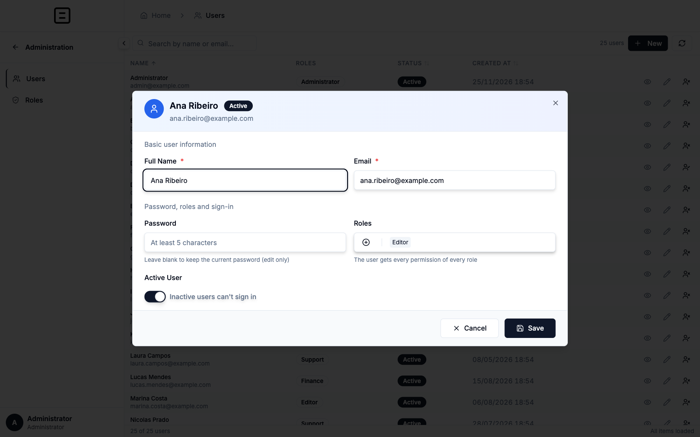
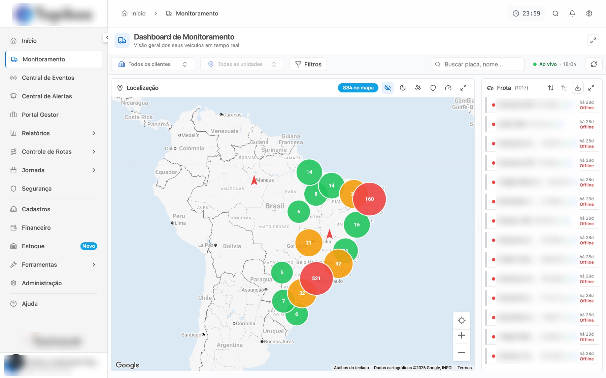
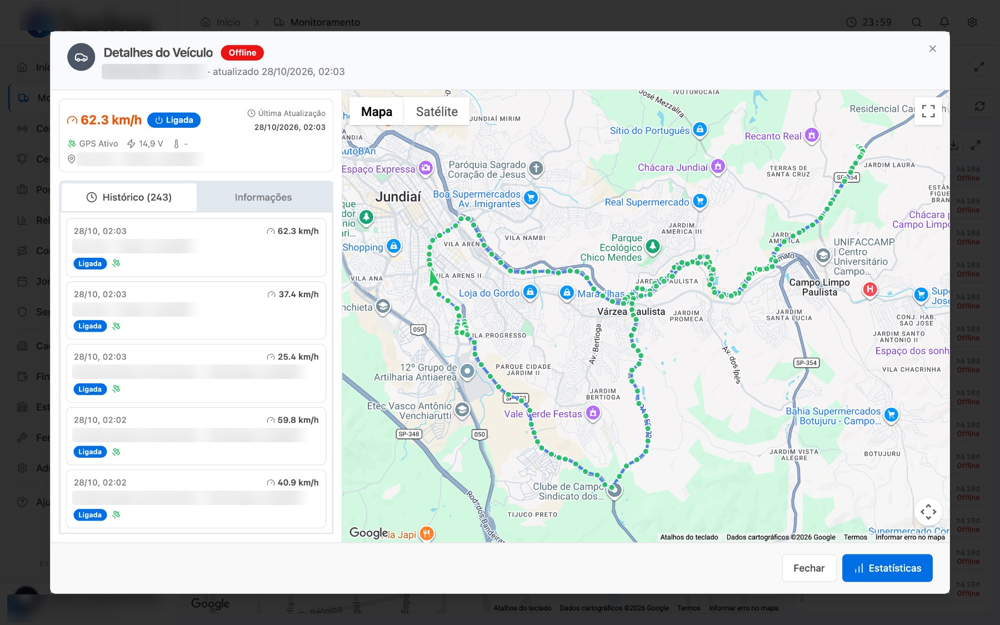
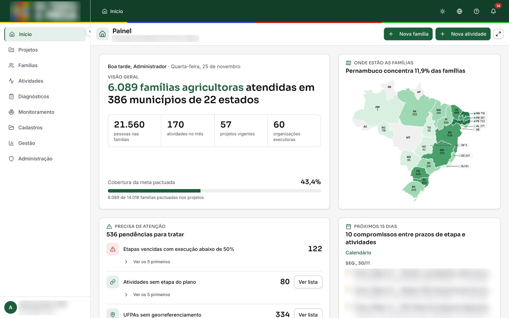
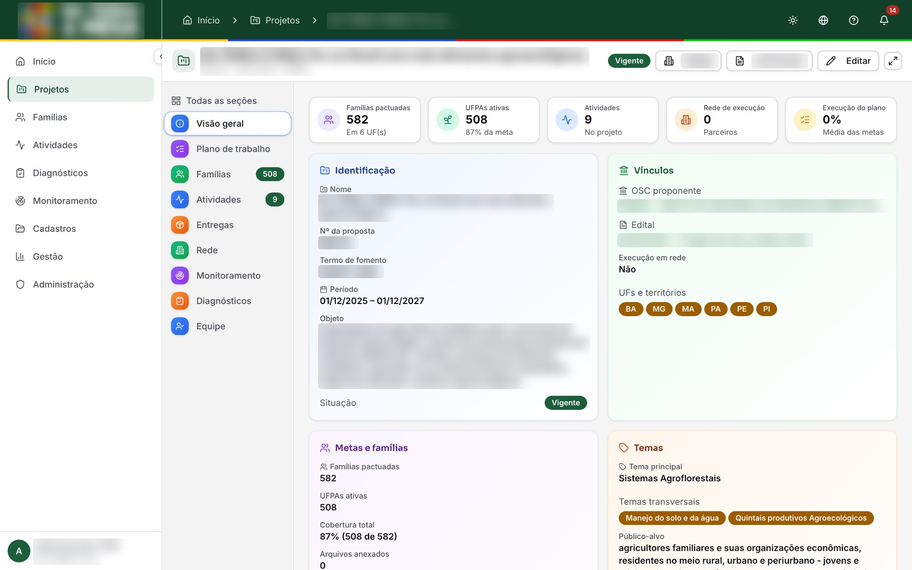
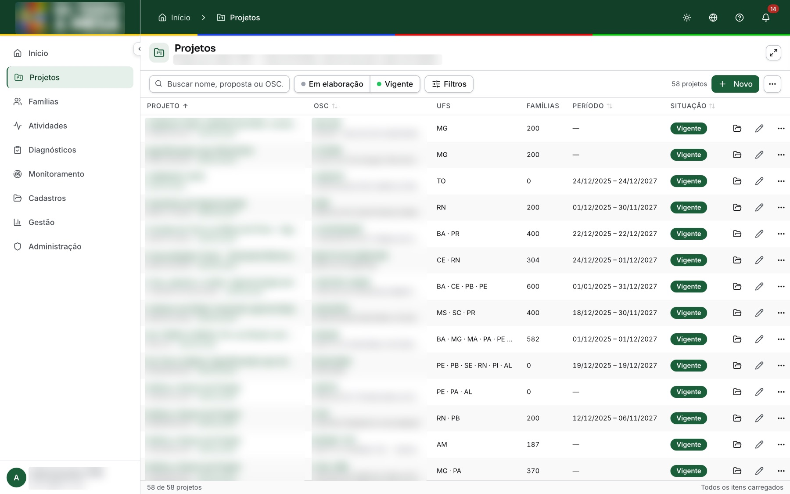
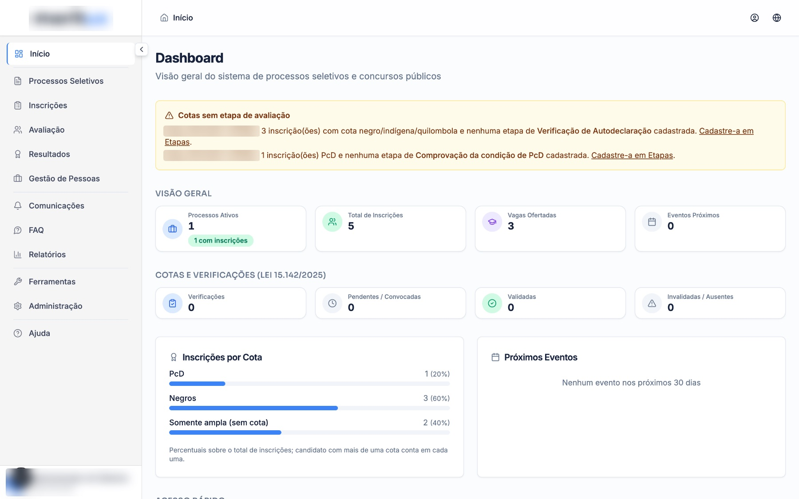

<div align="center">
  <picture>
    <source media="(prefers-color-scheme: dark)" srcset=".github/assets/logo-dark.svg">
    
  </picture>

  <p><strong>The admin framework that holds your systems up.</strong></p>

  <a href="https://github.com/telamonjs/telamonjs/actions/workflows/ci.yml"></a>
  <a href="https://www.npmjs.com/package/@telamonjs/ui"></a>
  <a href="./LICENSE"></a>

  <p>
    <a href="#get-started">Get started</a> ·
    <a href="https://telamonjs.com/docs">Docs</a> ·
    <a href="./apps/example">Example app</a> ·
    <a href="./CHANGELOG.md">Changelog</a> ·
    <a href="./CONTRIBUTING.md">Contributing</a>
  </p>
</div>

<p align="center">
  <a href="./apps/example"></a>
</p>

In classical architecture, a *telamon* is the sculpted figure that carries the
weight of the building. TelamonJS does the same for admin systems: declare what
a module is, and it holds up the list, the forms, the dialogs, the permissions
and the data layer around it. Built for Next.js on TanStack Query, Radix UI,
Tailwind CSS, Zod and React Hook Form.

## What you get

- **One object per module.** A `CrudConfig` declares the list, the form, the
  queries and the mutations; `ListPage` renders all of it.
- **Lists that hold up.** A virtualized table with infinite scroll, search,
  filters, sorting, exports and URL deep-linking.
- **Forms and dialogs.** Create, edit and view dialogs on a field system
  validated with Zod and React Hook Form.
- **Permissions with no query per request.** RBAC is materialized into the JWT,
  so every check is an array lookup.
- **A complete app shell.** Sidebar, Cmd+K command palette, dashboards, charts
  and pt-BR/en/es messages.
- **An API you can trust.** Accessibility is asserted with axe against real
  primitives, and the public API is pinned by a snapshot test and follows semver.
- **From zero in one command.** The CLI scaffolds an app and generates CRUD
  modules from your Prisma schema.

## Get started

```bash
npx -p @telamonjs/cli create-telamonjs-app my-admin
```

The CLI scaffolds a Next.js admin with sign-in, a reference CRUD module, the app
shell and pt-BR/en/es messages, then prints the remaining steps (database, env,
seed). Adding TelamonJS to an existing app instead? See the
[`@telamonjs/ui` README](./packages/ui/README.md).

## The core idea: `CrudConfig`

One object describes a module (list, form, queries and mutations) and
`ListPage` renders the whole experience:

```tsx
'use client'
import { type CrudConfig, ListPage } from '@telamonjs/ui'

export const config: CrudConfig<User, UserFormData> = {
  module: { name: 'users', title: 'Users', route: '/admin/users' },
  list: { title: 'Users', columns, searchPlaceholder: 'Search…' },
  form: { sections, validation: userSchema },
  query: { queryKey: ['users'], queryFn: usersApi.list }, // → PaginatedResponse<User>
  mutations: {
    create: { mutationFn: async d => ({ success: true, data: await usersApi.create(d) }), invalidates: [['users']] },
    update: { mutationFn: async ({ id, data }) => ({ success: true, data: await usersApi.update(id, data) }), invalidates: [['users']] },
    delete: { mutationFn: async ({ id }) => { await usersApi.delete(id); return { success: true } }, invalidates: [['users']] },
  },
}

// page.tsx
<ListPage<User> config={config} />
```

You get a virtualized table with infinite scroll, toolbar, filters,
create/edit/view dialogs, exports and URL deep-linking.

## Built with TelamonJS

Screens from systems in production on TelamonJS, with their data blurred.

<table>
  <tr>
    <td width="50%"><br><sub>Fleet tracking: live map and fleet list</sub></td>
    <td width="50%"><br><sub>Vehicle detail dialog with the recorded route</sub></td>
  </tr>
  <tr>
    <td><br><sub>Program dashboard with a choropleth map</sub></td>
    <td><br><sub>Entity portal: section rail, KPIs and detail cards</sub></td>
  </tr>
  <tr>
    <td><br><sub>A <code>ListPage</code> with status filters and row actions</sub></td>
    <td><br><sub>Selection process dashboard with alerts and breakdowns</sub></td>
  </tr>
</table>

## Packages

Each package works standalone.

| Package | What it does |
| --- | --- |
| [`@telamonjs/ui`](./packages/ui/README.md) | The admin framework: `CrudConfig` + `ListPage`, 36-type field system, dialogs, app shell with Cmd+K, dashboards, charts, i18n |
| [`@telamonjs/data`](./packages/data/README.md) | The server half of a list: the `ListPage` wire contract, sort and paging sanitizers, and a Prisma adapter (`orderBy`, scope-safe `where`, paginated services), with zero dependencies |
| [`@telamonjs/auth`](./packages/auth/README.md) | NextAuth v5 ↔ NestJS bridge: the JWE session-token contract, a Nest guard and revocable impersonation |
| [`@telamonjs/permissions`](./packages/permissions/README.md) | RBAC materialized into the JWT: every check is an array lookup, no database query per request |
| [`@telamonjs/logger`](./packages/logger/README.md) | One `ILogger` across browser, server and worker, with `audit()`, `perf()` and child loggers |
| [`@telamonjs/queue`](./packages/queue/README.md) | BullMQ job engine: config-driven jobs, Bull Board, Prometheus metrics and an HTTP backend for the ui queue dashboard |
| [`@telamonjs/cli`](./packages/cli/README.md) | `create-telamonjs-app` scaffolding, CRUD generation from a Prisma schema and a convention linter |

## Documentation

**[telamonjs.com](https://telamonjs.com/docs)** has the guides, the component
pages with live previews, the patterns and the reference of every package.
Each package README above covers install, a canonical example and the entry
points.

## Requirements

Node ≥ 22 · Next.js `^15.5.29 || ^16.4.6` · React 18 or 19

## Contributing

See [CONTRIBUTING.md](./CONTRIBUTING.md) for the build order, the example app,
the docs workflow and how releases work.

## Status

TelamonJS 1.0 is out. Every package runs its test suite in CI, accessibility is
asserted with axe against real primitives, and the public API is pinned by a
snapshot test and follows semver: a removed or renamed export means a new major.
Release notes live in [CHANGELOG.md](./CHANGELOG.md).

## License

[MIT](./LICENSE) © Marcos Tullyo. See [THIRD_PARTY_NOTICES.md](./THIRD_PARTY_NOTICES.md).
